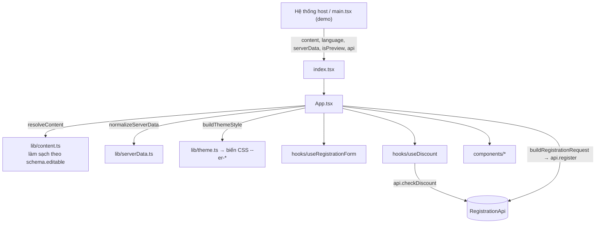

# Cấu trúc và chức năng các thành phần – Event Registration (Internet Day 2026)

Tài liệu mô tả cấu trúc thư mục, vai trò của từng file và luồng dữ liệu của dự án template React trang đăng ký sự kiện (vé miễn phí, song ngữ vi/en).

- **Công nghệ:** React 19, TypeScript, Tailwind CSS 4, Vite, `lucide-react`, `framer-motion`.
- **Sản phẩm bàn giao:** chỉ thư mục `src/template-internet-day/`. Hệ thống thật copy nguyên thư mục này và render `export default` với 5 prop.
- **Phần còn lại** (`main.tsx`, `mock/`, `scripts/`, `public/`) chỉ phục vụ chạy thử, kiểm tra và chụp ảnh.

---

## 1. Tổng quan thư mục

```
D:\NetNam\Dang_ky\
├── new 5.txt                                   # Đặc tả gốc (ưu tiên cao nhất khi mâu thuẫn)
├── BRD SRS – Trang đăng ký sự kiện (...).docx  # BRD/SRS do BA viết lại
├── background/                                 # Ảnh thiết kế tham khảo (PC Ver, Mobile Ver)
├── event-registration.zip                      # Gói nộp, tạo bằng git archive
└── event-registration/                         # ← DỰ ÁN
    ├── index.html               # HTML gốc của trang demo, nạp font Inter và src/main.tsx
    ├── package.json             # Script npm và dependency
    ├── vite.config.ts           # Vite + plugin React + plugin Tailwind
    ├── tsconfig*.json           # Cấu hình TypeScript (app / node / gốc "files": [])
    ├── .oxlintrc.json           # Cấu hình lint (oxlint)
    ├── CLAUDE.md                # Ràng buộc và hướng dẫn làm việc
    ├── README.md                # Hướng dẫn chạy, bảng trường content, checklist nghiệm thu
    ├── public/                  # favicon.svg, images/ (banner desktop/mobile, logo)
    ├── docs/                    # Ảnh chụp màn hình 360px, 1440px, màn xác nhận
    ├── dist/                    # Kết quả build (npm run build)
    ├── scripts/
    │   ├── check-schema.mjs     # Kiểm tra schema.json theo checklist đặc tả
    │   └── screenshots.mjs      # Chụp ảnh docs/*.png và thumbnail bằng Chrome headless
    └── src/
        ├── main.tsx             # Trang demo (không bàn giao)
        ├── index.css            # CSS của trang demo (import Tailwind)
        ├── mock/                # API giả + dữ liệu giả (không bàn giao)
        │   ├── serverData.json
        │   └── mockApi.ts
        └── template-internet-day/   # ★ THƯ MỤC BÀN GIAO
            ├── index.tsx
            ├── schema.json
            ├── template_metadata.json
            ├── thumbnail.png
            └── src/
                ├── App.tsx
                ├── types.ts
                ├── config.ts
                ├── formFields.ts
                ├── i18n.ts
                ├── hooks/       # useRegistrationForm, useDiscount
                ├── lib/         # content, theme, ui, request, serverData, format, validation
                └── components/  # 11 component giao diện
```

---

## 2. Kiến trúc tổng thể

### 2.1 Các lớp

| Lớp | File | Trách nhiệm |
|---|---|---|
| Điểm vào | `index.tsx` | `'use client'`, export default `RegistrationPage` nhận 5 prop rồi chuyển cho `App` |
| Ghép trang | `src/App.tsx` | Ghép các phần, giữ state submit / kết quả, gọi `api.register` |
| Khai báo | `types.ts`, `config.ts`, `formFields.ts`, `i18n.ts`, `schema.json` | Kiểu dữ liệu, hằng số, định nghĩa ô nhập, nhãn, nội dung theo sự kiện |
| State | `hooks/` | Giá trị và lỗi form; máy trạng thái mã ưu đãi |
| Logic thuần | `lib/` | Làm sạch content, sinh theme, dựng request, chuẩn hoá serverData, định dạng, validate |
| Giao diện | `components/` | Component trình bày, nhận dữ liệu qua props, không tự gọi API |

### 2.2 Nguyên tắc "mỗi loại thay đổi một chỗ"

| Loại thay đổi | Nơi sửa duy nhất |
|---|---|
| Chữ / ảnh / màu theo sự kiện | `schema.json` (`defaultData` + `editable`) và `RegistrationContent` trong `types.ts` |
| Quy tắc chung (regex, số vé, locale, preset bo góc, bố cục hero) | `config.ts` |
| Nhãn giao diện cố định | `i18n.ts` (đủ cả `vi` và `en`) |
| Thêm / bớt / đổi thứ tự ô nhập | `ATTENDEE_FIELDS` trong `formFields.ts` |
| Thêm một phần form | mảng `sections` trong `App.tsx` (số bước tự đánh lại) |
| Màu trạng thái (lỗi, thành công…) | `STATUS` trong `lib/theme.ts` |

### 2.3 Luồng dữ liệu



### 2.4 Ranh giới bắt buộc của thư mục template

- Không import từ `src/mock/` hay `main.tsx`; chỉ dùng import tương đối. (Chiều ngược lại được phép.)
- Không gọi `fetch` / `axios`: mọi lời gọi mạng đi qua prop `api`. Hai hàm của `api` không bao giờ ném lỗi; khi lỗi, `message` đã là câu cho khách đọc và hiển thị nguyên văn.
- Không dùng `any`, không dùng `localStorage`; comment viết bằng tiếng Anh.

---

## 3. Thư mục bàn giao `src/template-internet-day/`

### 3.1 File gốc

| File | Chức năng |
|---|---|
| `index.tsx` | Điểm vào. Khai báo `'use client'`, export default component nhận `RegistrationPageProps` |
| `schema.json` | 6 khoá gốc: `name`, `version`, `author`, `language` (`["vi","en"]`), `defaultData` (nội dung mặc định), `editable` (mô tả field cho editor, cây khoá trùng `defaultData`) |
| `template_metadata.json` | `id` (UUID), tiêu đề, mô tả, phiên bản, tác giả, ngày tạo, tên file thumbnail |
| `thumbnail.png` | Ảnh đại diện 800 × 450 |

**Props của template** (`RegistrationPageProps` trong `types.ts`):

| Prop | Kiểu | Ý nghĩa |
|---|---|---|
| `content` | `{ defaultData: RegistrationContent }` | Nội dung do ban tổ chức chỉnh trong editor |
| `language` | `'vi' \| 'en'` | Ngôn ngữ trang |
| `serverData?` | `ServerData` | Tên sự kiện, loại vé, các ngày; có thể thiếu khi preview |
| `isPreview?` | `boolean` | Chế độ xem trước: validate được nhưng không gọi `register` |
| `api` | `RegistrationApi` | `checkDiscount()` và `register()` |

### 3.2 `src/` – các file khai báo

| File | Chức năng |
|---|---|
| `App.tsx` | Component gốc. Chuẩn hoá đầu vào (`resolveContent`, `normalizeServerData`, `buildThemeStyle`); tính vé/ngày đã chọn, tạm tính, giảm giá, tổng; xử lý submit (chặn gọi hai lần bằng `submittingRef`, focus ô lỗi đầu tiên, nhánh `isPreview`, gọi `api.register`); hiển thị form hoặc màn xác nhận qua `AnimatePresence`; xoá thông báo của server khi đổi ngôn ngữ. Mảng `sections` có cờ `visible`, số bước tự đánh |
| `types.ts` | Kiểu chép **nguyên văn** từ đặc tả (`TicketType`, `Session`, `ServerData`, `RegistrationPageProps`, `ApiResult`, `DiscountRequest/Result`, `RegistrationRequest/Result`, `HolderInfo`, `RegistrationApi`), cộng `RegistrationContent` và `AgendaItem` do template tự thiết kế, khớp `defaultData` |
| `config.ts` | Hằng số chung: `TICKET_QUANTITY = 1`, `MIN_SESSIONS_FOR_PICKER = 2`, regex email/điện thoại, định dạng giá `vi-VN` + " đ", locale ngày, `RADIUS_PRESETS`, `HERO_LAYOUTS`, `MIN_CONTRAST = 4.5`, `COPY_FEEDBACK_MS`, `SAFE_URL` |
| `formFields.ts` | Khai báo dạng dữ liệu của form. `ATTENDEE_FIELDS` (họ tên, email, điện thoại, công ty, chức danh) gồm id, kiểu input, autocomplete, khoá nhãn, hàm validate/normalize, điều kiện hiển thị, `issuerKey`/`holderKey` để map sang payload. Có thêm `EMPTY_FORM`, `CHOICE_FIELD_SELECTORS`, `visibleAttendeeFields`, `validateField`, `validateForm`, `fieldOrder` |
| `i18n.ts` | Từ điển nhãn cố định `vi` và `en`. Kiểu `Dictionary` suy ra từ `vi` nên thiếu nhãn bên `en` sẽ báo lỗi kiểu. `TextKey` là khoá có giá trị string, dùng làm khoá lỗi. `getDictionary(lang)` |

### 3.3 `src/hooks/`

| Hook | Chức năng |
|---|---|
| `useRegistrationForm(ctx)` | Giữ `values`, `errors`, `submitAttempted`. Validate khi blur (bỏ qua ô trống trước lần submit đầu), validate trực tiếp sau khi đã submit hoặc khi ô đang có lỗi. `validateAll()` trả về các ô lỗi theo thứ tự trên màn hình. Lỗi lưu dạng khoá i18n nên tự dịch khi đổi ngôn ngữ. Có `reset()` |
| `useDiscount(api)` | Máy trạng thái mã ưu đãi: `idle` → `loading` → `applied` / `error` / `error-key`. Chuẩn hoá mã (trim + viết hoa); bắt buộc chọn vé trước; dùng `requestId` để bỏ qua response cũ; đổi mã hoặc đổi vé thì huỷ mã đã áp; `dropServerMessage()` khi đổi ngôn ngữ |

### 3.4 `src/lib/` – logic thuần, không phụ thuộc React

| File | Chức năng |
|---|---|
| `content.ts` | `resolveContent()` duyệt `schema.editable` để làm sạch content: `select` phải nằm trong `options`, `number` bị kẹp theo `min`/`max`, `color` phải là hex, `url`/`image` chặn scheme lạ (vd `javascript:`), `repeater` phải là mảng; thiếu hoặc sai thì lấy giá trị mặc định trong schema. Thêm field vào schema không cần sửa file này. `localize()` chọn chữ theo ngôn ngữ, thiếu thì lấy ngôn ngữ còn lại |
| `theme.ts` | `buildThemeStyle()` chuyển khối `Theme` thành biến CSS `--er-*` (primary, accent, bg, surface, muted, border, ink, ring, radius…). Tự chọn chữ đen/trắng theo độ tương phản WCAG; bộ màu trạng thái `danger/success/info/warning` riêng cho thẻ nền sáng và nền tối |
| `ui.ts` | Chuỗi class Tailwind dùng chung: `focusRing`, `card`, `badge`, `buttonPrimary/Secondary`, `inputBase` + `inputState()`, `notice`. Phong cách Swiss: phẳng, viền mảnh, không bóng, focus outline 2px |
| `request.ts` | `buildRegistrationRequest()` map form sang payload `register` theo `issuerKey`/`holderKey` (người giữ vé = người đặt, bỏ trường tuỳ chọn để trống, `registered_session` là `[code]` hoặc `[]`, `discount_code` chỉ khi đã áp thành công). `buildDiscountRequest()` |
| `serverData.ts` | `normalizeServerData()`: dữ liệu thiếu hoặc hỏng thành danh sách rỗng, không ném lỗi; `needsSession` khi có từ 2 ngày. `getTicketStatus()`: `available` / `sold_out` / `not_on_sale` / `sale_ended`. `describeSession()` tạo nhãn ngày giờ |
| `format.ts` | `parsePrice`, `formatPrice` ("150.000 đ"), `formatDate`, `formatTimeRange`, `formatDateTime`, `toTime` |
| `validation.ts` | `normalizePhone` (bỏ dấu cách, chấm, gạch), `isValidEmail`, `isValidPhone` |

### 3.5 `src/components/` – giao diện

| Component | Chức năng |
|---|---|
| `EventIntro` | Phần giới thiệu: banner desktop/mobile, logo, tagline, tiêu đề, thời gian, địa điểm, mô tả, nút "Đăng ký ngay" cuộn tới form. Bố cục `overlay` (chữ đè banner, có khoảng trống phía trên theo `overlayOffset*`) hoặc `stacked` |
| `Agenda` | Lịch trình từ repeater `Agenda`; ẩn khi không có mục nào |
| `TicketPicker` | Danh sách loại vé (radio). Vé hết, chưa mở bán hoặc đã ngừng bán vẫn hiện nhưng bị vô hiệu kèm nhãn; hiện số vé còn lại; danh sách rỗng thì hiện thông báo |
| `SessionPicker` | Chọn ngày tham dự; chỉ render khi có ít nhất 2 ngày |
| `AttendeeSection` | Render các ô nhập từ `ATTENDEE_FIELDS` và ô đồng ý điều khoản (kèm link `termsUrl` nếu có) |
| `Field` | Ô nhập có nhãn, gợi ý, thông báo lỗi; gắn `aria-*` cho trợ năng |
| `DiscountField` | Ô mã ưu đãi + nút Áp dụng / Bỏ mã; lỗi hiện ngay dưới ô; có hiệu ứng `framer-motion` |
| `OrderSummary` | Tóm tắt (vé, ngày, tạm tính, giảm giá, tổng), nút Gửi, trạng thái đang xử lý, thông báo preview, lỗi validate và lỗi API hiện ngay dưới nút. Dính (sticky) cột phải trên màn rộng |
| `Confirmation` | Màn cảm ơn: mã vé (có nút sao chép qua `navigator.clipboard`), ảnh QR, mã đơn, thông tin đã đăng ký, thông báo đã gửi email, nút "Đăng ký mới" đưa về form trống |
| `SectionHeading` | Tiêu đề phần có số bước dạng `01`, `02`… dùng chung cho các bước form |
| `SiteFooter` | Chân trang: tên ban tổ chức, email, hotline; mục nào trống thì ẩn |

### 3.6 Bảng trường `schema.json → defaultData`

| Khối | Trường chính |
|---|---|
| `customCSS` | CSS tuỳ chỉnh (mặc định rỗng) |
| `metadata` | `title`, `description` (vi/en), `icon` |
| `Theme` | `primaryColor`, `accentColor`, `backgroundColor`, `surfaceColor`, `radius` (`none/small/medium/large`) |
| `Hero` | `layout`, `overlayOffsetMobile/Desktop`, `bannerDesktop/Mobile`, `logo`, `tagline`, `title`, `time`, `location`, `description` |
| `Agenda[]` | `{ time, label{vi,en} }` |
| `Form` | `showDiscount`, `showCompany`, `showPosition`, `termsText`, `termsUrl` |
| `Confirmation` | `thankYouTitle`, `thankYouMessage` |
| `Organizer` | `name`, `contactEmail`, `hotline` |

Khi thêm hoặc đổi trường, sửa cùng lúc 3 chỗ: `defaultData`, `editable`, `RegistrationContent`. Sau đó chạy `npm run check:schema` và `npm run typecheck`.

---

## 4. Phần chạy thử (không bàn giao)

| File | Chức năng |
|---|---|
| `src/main.tsx` | Trang demo. Truyền `content={{ defaultData: schema.defaultData }}` đúng như đặc tả. Thanh Demo đổi ngôn ngữ; mục **Demo options** bật/tắt `isPreview`, đổi `serverData` (mặc định / 1 ngày / thêm vé có phí / không có), đổi `content` (schema / giao diện khác / content hỏng), xem số lần gọi `register()` và request gần nhất |
| `src/mock/serverData.json` | Dữ liệu giả chép nguyên từ đặc tả (vé General, VIP hết vé; 2 ngày D1, D2). Không được sửa |
| `src/mock/mockApi.ts` | `createMockApi()` hiện thực `RegistrationApi`, chờ 800 ms mỗi lần gọi. `SALE10` giảm 10%, mã khác báo lỗi. Email bắt đầu bằng `trung` / `hetve` / `nhanh` / `matmang` trả lỗi tương ứng (trùng đăng ký / hết vé / thao tác nhanh / mất mạng); email khác trả mã vé và URL QR. Câu lỗi theo ngôn ngữ |
| `src/index.css` | CSS toàn cục của trang demo |

---

## 5. Script và cấu hình

| File / lệnh | Chức năng |
|---|---|
| `npm run dev` | Chạy trang demo tại `http://localhost:5173` |
| `npm run build` | `tsc -b && vite build` → `dist/` |
| `npm run typecheck` | `tsc --noEmit -p tsconfig.app.json`: kiểm tra kiểu thật sự (`npx tsc --noEmit` ở gốc không kiểm tra file nào vì `"files": []`) |
| `npm run lint` | `oxlint` (luật `rules-of-hooks`, `only-export-components`) |
| `npm run check:schema` | `scripts/check-schema.mjs`: kiểm tra 6 khoá gốc, cây khoá `editable` trùng `defaultData`, kiểu field hợp lệ, label tiếng Anh, chữ đủ vi/en, `select` có `options`/`default`, `number` trong `min`/`max`, màu hex, nội dung tối thiểu |
| `node scripts/screenshots.mjs <url>` | Mở Chrome headless qua CDP, ẩn thanh demo, chụp `docs/screenshot-1440.png`, `docs/screenshot-360.png`, `docs/confirmation-360.png` (tự điền và gửi form) và `thumbnail.png` 1600 × 900 (cần thu nhỏ về 800 × 450), đồng thời báo có cuộn ngang hay không |
| `vite.config.ts` | Plugin `@vitejs/plugin-react` và `@tailwindcss/vite` |

---

## 6. Luồng đăng ký từ đầu đến cuối

1. Host render template với 5 prop. `App` làm sạch `content`, chuẩn hoá `serverData`, sinh biến CSS theme.
2. Khách chọn vé (`TicketPicker`). Nếu có từ 2 ngày thì chọn ngày (`SessionPicker`).
3. Khách điền thông tin (`AttendeeSection`). Lỗi hiện khi rời ô, sau lần submit đầu thì cập nhật trực tiếp.
4. *(Tuỳ chọn)* Nhập mã ưu đãi → `useDiscount.apply()` → `api.checkDiscount()` → `OrderSummary` cập nhật giảm giá và tổng.
5. Bấm **Gửi đăng ký**:
   - Validate toàn bộ. Có lỗi thì báo số lỗi và focus ô lỗi đầu tiên.
   - `isPreview = true` thì chỉ báo form hợp lệ, không gọi API.
   - Ngược lại: `buildRegistrationRequest()` → `api.register()` (chỉ một lần nhờ `submittingRef`).
6. Thành công → `Confirmation` hiện mã vé, QR, mã đơn. Lỗi → câu lỗi của server hiện dưới nút Gửi, dữ liệu form giữ nguyên.
7. **Đăng ký mới** → reset form và mã ưu đãi, quay lại form trống.
