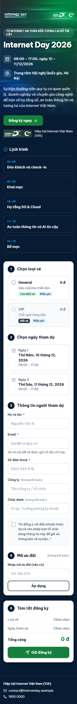
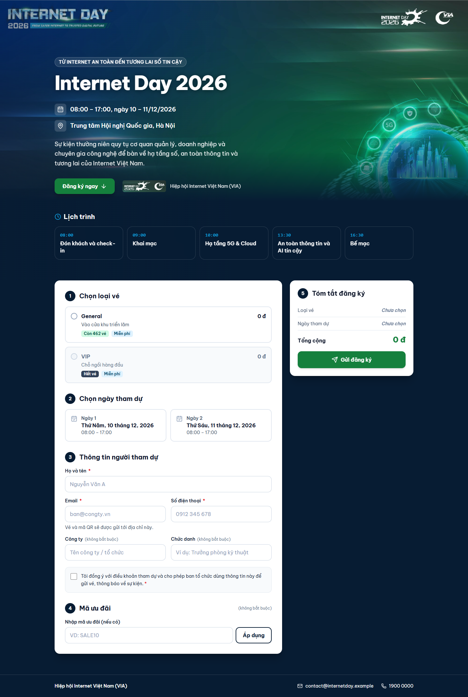

# Template Internet Day – trang đăng ký sự kiện

Đây là component React cho trang đăng ký tham dự sự kiện vé miễn phí, có đủ tiếng Việt và tiếng Anh. Khách xem thông tin sự kiện, chọn loại vé và ngày, điền thông tin, nhập mã ưu đãi nếu có, gửi đăng ký rồi nhận mã vé kèm QR.

Công nghệ: React 19, TypeScript, Tailwind CSS 4, Vite, lucide-react, framer-motion.

## Cách chạy

```bash
npm install
npm run dev            # trang demo: http://localhost:5173
npm run build          # tsc -b && vite build
npx tsc --noEmit       # kiểm tra kiểu (hoặc: npm run typecheck)
npm run check:schema   # kiểm tra schema.json theo checklist phần schema
```

Không cần cấu hình gì thêm.

### Trang demo (`src/main.tsx`)

Trang demo đọc schema giống cách hệ thống sẽ đọc: `content={{ defaultData: schema.defaultData }}`. Thanh **Demo** ở đầu trang có nút đổi ngôn ngữ vi/en. Mục **Demo options** dùng để thử các trường hợp biên:

- bật/tắt `isPreview`;
- chọn `serverData`:
  - `serverData.json` (dữ liệu giả chép nguyên từ đặc tả);
  - chỉ có 1 ngày;
  - thêm một vé có phí;
  - không có dữ liệu;
- dùng content thiếu trường hoặc sai kiểu;
- xem `register()` đã được gọi bao nhiêu lần và request gần nhất.

### Thử 6 tình huống của mock

| Thao tác | Kết quả |
|---|---|
| Nhập mã `SALE10` (chọn *+ paid ticket*, vé Workshop) | Giảm 10%: 150.000 đ → 135.000 đ |
| Nhập mã khác | "Mã giảm giá không hợp lệ hoặc đã hết hạn." hiện dưới ô mã |
| Email thường, ví dụ `a@example.com` | Màn xác nhận có mã vé và QR |
| Email bắt đầu bằng `trung` / `hetve` / `nhanh` / `matmang` | Câu lỗi tương ứng hiện dưới nút Gửi, form giữ nguyên dữ liệu |

Mỗi lần gọi mock chờ 800 ms. Khi trang ở tiếng Anh, mock trả câu tiếng Anh.

## Cấu trúc

```
src/
├── template-internet-day/          # THƯ MỤC BÀN GIAO
│   ├── index.tsx                   # 'use client' + export default component chính
│   ├── schema.json                 # defaultData + editable
│   ├── template_metadata.json      # id là UUID mới
│   ├── thumbnail.png               # 800 × 450
│   └── src/
│       ├── App.tsx                 # bố cục trang, chuyển giữa form và màn xác nhận
│       ├── components/             # EventIntro, TicketPicker, SessionPicker, Field,
│       │                           # DiscountField, OrderSummary, Confirmation, SectionHeading
│       ├── i18n.ts                 # nhãn cố định, đủ vi và en
│       ├── types.ts                # kiểu chép nguyên từ đặc tả + RegistrationContent
│       └── utils.ts                # ghép content với giá trị dự phòng, định dạng giá/ngày, kiểm tra form
├── mock/                           # chỉ để chạy thử, không bàn giao
│   ├── serverData.json
│   └── mockApi.ts
└── main.tsx                        # trang demo
public/images/                      # banner desktop/mobile + logo Internet Day
scripts/                            # check-schema.mjs, screenshots.mjs
```

Template không dùng file `index.css` riêng vì toàn bộ style viết bằng class Tailwind.

Các ràng buộc của thư mục template:

- Không import gì từ `mock/` hay `main.tsx`. Import nội bộ đều dùng đường dẫn tương đối.
- Không gọi `fetch` hay `axios`. Mọi lời gọi API đi qua prop `api`.
- Không dùng `any` hay `localStorage`.
- Comment viết bằng tiếng Anh.

## Bảng trường `content.defaultData`

| Đường dẫn | Kiểu field | Ý nghĩa |
|---|---|---|
| `customCSS` | code (css) | CSS tuỳ chỉnh, mặc định `""` |
| `metadata.title`, `metadata.description` | block vi/en | Tiêu đề tab, mô tả khi chia sẻ link |
| `metadata.icon` | image | Favicon |
| `Theme.primaryColor` | color | Màu nút và điểm nhấn chính |
| `Theme.accentColor` | color | Màu nhấn phụ (icon, giờ trong lịch trình) |
| `Theme.backgroundColor` | color | Màu nền trang |
| `Hero.bannerDesktop` / `Hero.bannerMobile` | image | Banner từ 768 px trở lên / dưới 768 px |
| `Hero.logo` | image | Logo ở phần giới thiệu và màn xác nhận |
| `Hero.tagline`, `Hero.title`, `Hero.time`, `Hero.location` | block vi/en | Thông tin sự kiện |
| `Hero.description` | block vi/en (textarea) | Mô tả ngắn |
| `Agenda[]` | repeater `{ time, label{vi,en} }` | Lịch trình |
| `Form.showDiscount`, `Form.showCompany`, `Form.showPosition` | toggle | Bật/tắt ô mã ưu đãi, ô công ty, ô chức danh |
| `Form.termsText` | block vi/en (textarea) | Nội dung ô đồng ý điều khoản |
| `Form.termsUrl` | url | Link điều khoản đầy đủ, để trống thì ẩn |
| `Confirmation.thankYouTitle`, `Confirmation.thankYouMessage` | block vi/en | Lời cảm ơn trên màn xác nhận |
| `Organizer.name` | block vi/en | Tên ban tổ chức (chân trang, phần giới thiệu) |
| `Organizer.contactEmail` / `Organizer.hotline` | email / tel | Liên hệ ở chân trang |

Thiếu trường nào hoặc sai kiểu thì template dùng giá trị trong `schema.json`. Màu không phải mã hex hợp lệ thì dùng màu mặc định. Chữ trên nút và trên nền tự chuyển đen hoặc trắng theo độ sáng của màu, nên vẫn đọc được khi ban tổ chức đổi màu.

## Ảnh chụp màn hình

| 360 px | 1440 px |
|---|---|
|  |  |

Màn xác nhận ở 360 px: [docs/confirmation-360.png](docs/confirmation-360.png).

Để chụp lại, chạy dev server rồi `node scripts/screenshots.mjs http://localhost:5173/`.

## Tự kiểm tra trước khi nộp

- [x] `npm install` rồi `npm run dev` chạy được ngay.
- [x] `npm run build` và `npx tsc --noEmit` không lỗi.
- [x] Thư mục template đúng cấu trúc; không import từ `mock/` hay `main.tsx`; không gọi `fetch`/`axios`.
- [x] `types.ts` đúng tên trường như đặc tả.
- [x] Đủ 7 phần giao diện.
- [x] Vé VIP (hết vé) hiện nhưng không chọn được.
- [x] Đăng ký thành công có mã vé và QR. Nút Đăng ký mới đưa về form trống.
- [x] Đủ 6 tình huống mock, câu lỗi hiện đúng chỗ, dữ liệu form còn nguyên.
- [x] Bấm Gửi liên tục chỉ gọi `register` một lần.
- [x] Form báo lỗi khi để trống, sai email, sai số điện thoại, chưa tick điều khoản.
- [x] `registered_session` gửi `["D1"]` / `["D2"]`; khi chỉ có 1 ngày thì gửi `[]`.
- [x] Đổi `language` thì toàn bộ chữ đổi theo (xem ghi chú 2).
- [x] Content thiếu trường, hoặc không có `serverData` với `isPreview = true`: trang vẫn hiện, không lỗi.
- [x] Ở 360 px không có cuộn ngang. Điền và gửi được bằng bàn phím.
- [x] Chỉ dùng lucide-react và framer-motion ngoài React, Tailwind, Vite.
- [x] `schema.json` hợp lệ, đủ 6 khoá gốc, có `customCSS` và `metadata`. Cây khoá của `defaultData` và `editable` khớp nhau. Kiểm tra bằng `npm run check:schema`.
- [x] Đủ nội dung tối thiểu ở quy tắc 4. Mọi chữ có cả vi và en.
- [x] Đổi chữ, màu hoặc thêm một dòng `Agenda` trong `defaultData` thì trang demo đổi theo.
- [x] Có `template_metadata.json` với UUID mới và `thumbnail.png`.

## Ghi chú và điểm cần anh xác nhận

1. **Ảnh mặc định chưa phải URL đầy đủ.** Quy tắc 6 yêu cầu URL đầy đủ, nhưng banner và logo Internet Day hiện là file local trong `public/images/`, nên schema đang ghi `/images/...`. Khi có CDN, hoặc khi ban tổ chức tải ảnh lên editor, sẽ thay bằng URL đầy đủ.
2. **Một phần chữ không đổi theo ngôn ngữ.** Tên vé, mô tả vé và tên ngày lấy nguyên từ `serverData`, nên vẫn là tiếng Việt khi trang ở tiếng Anh. Ký hiệu "đ" giữ nguyên vì đặc tả yêu cầu định dạng giá theo `vi-VN`.
3. **Mã ưu đãi với dữ liệu mẫu giảm 0 đ.** Mọi vé trong `serverData.json` đều giá `0.00`, nên `SALE10` giảm 0 đ. Trang demo có thêm lựa chọn *+ paid ticket* (vé Workshop 150.000 đ) để thấy được số tiền giảm. File `serverData.json` vẫn giữ nguyên như đặc tả.
4. **Nhãn cho vé đã hết hạn bán là tự chọn.** Vé chưa tới giờ mở bán ghi "Chưa mở bán". Vé đã qua `sale_end_time` đang ghi "Đã ngừng bán", vì đặc tả chưa nêu nhãn cho trường hợp này.
5. **Dữ liệu mẫu sẽ hết hạn bán.** `sale_end_time` trong dữ liệu mẫu là 01/12/2026. Sau ngày này mọi vé đều không chọn được, nên muốn thử luồng đăng ký phải sửa ngày trong `src/mock/serverData.json`.
